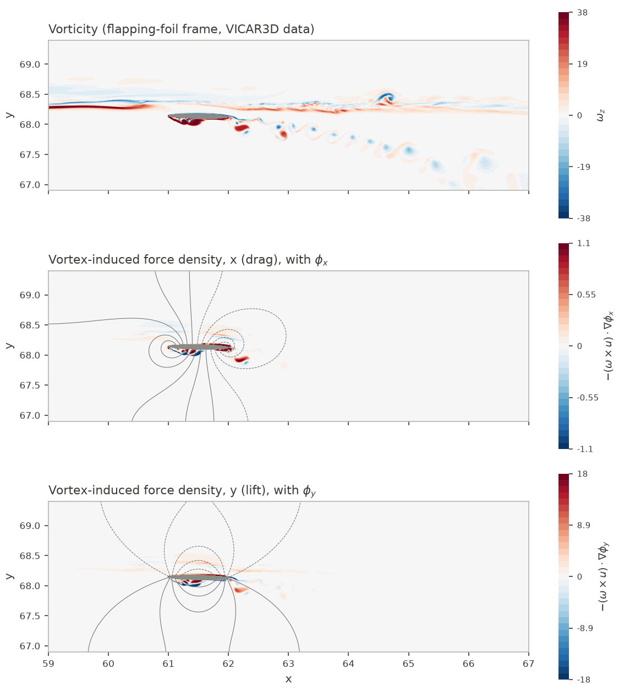
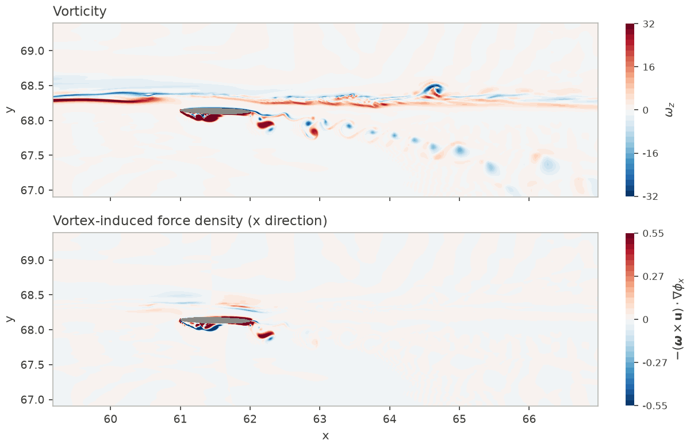
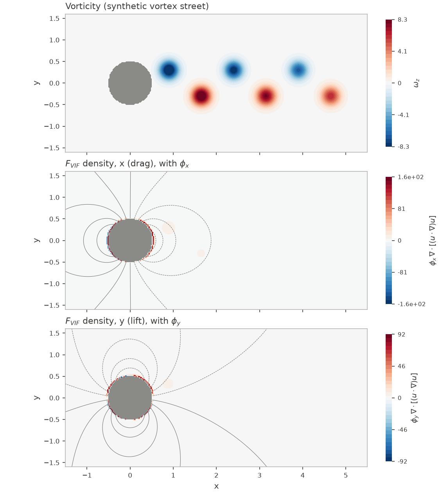

# FlowFPM++

Force-partitioning influence fields and vortex-induced forces on CPUs and
NVIDIA GPUs, in Fortran 2018 with MPI and OpenACC.



*Real data, reproducible from this repository (`make foil`): one frame of a
2-D flapping-foil simulation computed with the VICAR3D code, with the foil as
a stair-step body. Top: vorticity. Middle and bottom: vortex-induced force
density for drag and lift, with the influence potentials phi_x and phi_y as
contour lines (dashed where negative). Tens of seconds on one CPU core, about
2 s on one A100.*

## What it computes

The force-partitioning method (FPM) splits the pressure force on a body into
contributions from vorticity, added mass, viscous effects, and so on. It does
this by projecting the momentum equation onto one auxiliary *influence
potential* per force direction. For direction `i`, `phi_i` solves

```
laplacian(phi_i) = 0          in the fluid
n . grad(phi_i)  = n_i        on the body surface
n . grad(phi_i)  = 0          on the outer boundary
```

The vortex-induced force is then a volume integral over the fluid:

```
F_i(vortex) = -rho * integral_fluid (omega x u) . grad(phi_i) dV
```

FlowFPM++ solves for `phi_i` and evaluates the local densities
`-(omega x u) . grad(phi_i)` and `-a . grad(phi_i)` (for a supplied field `a`)
together with their integrals (per unit density). It does not include the
surface terms of the full FPM decomposition.

### Discretization

- **Grid.** Cell-centred, second order on stretched Cartesian grids.
- **Body: stair-step (blocked cells).** Cells whose centres lie inside the
  body are solid. They are excluded from the solve and hold `phi = 0`. Every
  face between a fluid and a solid cell carries the body condition. The
  condition `n . grad(phi_i) = n_i` does not change when `n` flips sign, so on
  a grid-aligned face it reduces to prescribing the face gradient along that
  face's axis: 1 on faces normal to axis `i`, 0 on the others. Near the body
  the geometry is only first-order accurate (see Validation).
- **Compatibility.** A pure Neumann problem needs the source and the boundary
  flux to balance. One uniform correction to the outer-boundary data enforces
  this (it is zero to roundoff for a closed body).
- **Gauge.** The fluid-volume mean of `phi` is removed.
- **Solvers.** The default is preconditioned conjugate gradients (PCG).
  Scaled by cell volume, the operator is symmetric positive semidefinite, with
  the constants as its null space. Compatibility keeps the right-hand side
  orthogonal to them, and a diagonal preconditioner is applied. At every
  convergence check the recursively updated residual is replaced by the true
  one, which keeps the iteration stable near roundoff. The alternative is
  weighted Jacobi, `phi <- 0.2 phi + 0.8 (sum(a_nb phi_nb) - f) / sum(a_nb)`,
  whose damping removes the checkerboard two-cycle of plain Jacobi on this
  operator. Jacobi is kept as the bandwidth benchmark. Both stop on the same
  max-norm residual of `L(phi) - f`.
- **Force terms.** Cell gradients are the average of the two face gradients
  on each axis, using the prescribed values on outer and body faces.

## Design

- **One code path.** Every solver routine takes a `use_openacc` switch. The
  CPU reference is the same source with OpenACC disabled, so CPU/GPU
  comparisons use the same algorithm and memory layout.
- **Mask-free sweep.** Prescribed outer and body face gradients are folded
  once into a source array, and solid and outer neighbours are dropped from a
  precomputed diagonal. Solid cells stay at zero, so the Jacobi and PCG kernels
  read no masks.
- **Device-resident frame.** The operator arrays are built on the device, and
  the sweeps ping-pong between two buffers. Unknowns already on the device are
  not copied again, so a caller's data region can keep the flow fields and
  `phi` resident from the solve through the force terms (the benchmark does
  this). Per sweep, only the one-layer x-y halo faces cross the host-device
  boundary, and noncontiguous x faces are packed on the device into one
  transfer per face.
- **MPI.** 2-D (x-y) Cartesian decomposition with host-staged halo messages;
  z is not decomposed.
- **Double precision** throughout.
- **Instrumented.** NVTX ranges mark setup, iterations, gauge, and the
  force-term kernel. They compile to no-ops in CPU builds.

## Validation

Every test generates its own inputs; none needs external data. Tests check
both solvers and fail on any non-finite value.

**Exact discrete solution** (`tests/test_stairstep_exact_3d.f90`). The grid is
stretched, 24x20x10, with four blocked bodies, one of them touching the outer
boundary. With a constant face gradient `g` on the body and outer faces, the
field `phi = g . x` solves the discrete problem exactly, and its gradient and
force densities have closed forms. The test checks this on 1, 4, and 6 ranks
on the CPU, and on 1 and 4 ranks on the GPU:

| Quantity | Jacobi (to 1e-12, 14,500 sweeps) | PCG (to 1e-10, 200 iterations) |
|---|---|---|
| phi | 1.0e-13 | 9.9e-14 |
| Gradient | 3.4e-13 | 5.9e-13 |
| Vortex density | 2.9e-13 | 7.0e-13 |
| Distributed vs one-rank field | 3.6e-16 (600 fixed sweeps) | 6.7e-16 (converged) |

**Sphere convergence** (`tests/test_stairstep_sphere_3d.f90`). The x
influence potential of a sphere of radius `a` is the dipole
`phi = -a^3 x / (2 r^3)`. The test imposes its gradient on the outer faces of
the box `[-3a, 3a]^3` and compares the fluid field with it. The added-mass
coefficient `C_m = -(1/V) * integral(phi n_x dA)` has the exact value 1/2.

| N^3 | PCG iterations (Jacobi sweeps) | RMS error | Far-field (r > 2a) max error | C_m |
|---|---|---|---|---|
| 12 | 100 (2,100) | 1.08e-2 | 2.24e-2 | 0.897 |
| 24 | 200 (8,800) | 9.27e-3 | 1.87e-2 | 0.770 |
| 48 | 300 (35,600) | 4.56e-3 | 9.21e-3 | 0.639 |
| 96 | 500 (143,000) | 2.14e-3 | 4.38e-3 | 0.566 |

The observed order approaches 1 for all three quantities (1.09, 1.07, and
1.06 on the finest refinement). That is the expected accuracy of a
stair-step body: usable, but a sharp-interface method would be needed for
precise surface quantities.

**Real frame** (`examples/foil_frame_fpm.f90`, `make foil`). The frame is
cropped to 741x518 cells around the foil and wake, and 2,597 of them are
solid. The influence fields are solved on the cropped domain, with zero normal
derivative on its outer boundary. The stair-step x vortex-induced force over
the crop is -2.131e-2 (per unit span and density). The VICAR3D code's own
value for the same crop is -1.788e-2. Its influence field comes from the full
domain and a sharp-interface body. The 19% difference combines the crop and
the stair-step body, and shows what the simpler geometry costs on a real,
thin foil. CPU and GPU give identical integrals to eight digits.

**CPU/GPU parity.** On every benchmark grid the GPU field matches the CPU
field to a maximum difference of 2.8e-17 for fixed work, and 2.5e-16 for PCG
converged to 1e-8.
Results are reproducible only to roundoff, because the order of GPU
reductions varies from run to run.

**Toolchains.** The CPU suite passes with GNU Fortran 13 and Open MPI 4.1,
and with Intel `ifx` and Intel MPI; CI runs the GNU build.

## Performance

Hardware: one NVIDIA A100-PCIE-40GB; Intel Xeon Gold 6248R (2 x 24 cores),
of which 1 or 16 ranks are bound to cores. Software: NVIDIA HPC SDK 25.5; one
binary built with `-O2 -acc -gpu=cc80` serves both the CPU and GPU runs.
Workload: `benchmark_stairstep_3d`, the x influence field of a stair-step
sphere on a stretched grid followed by the FPM terms. Times are medians of
three runs after a warm-up.

**Time to solution** (compatibility, solve to max-norm residual 1e-8, gauge,
and force terms, including all host-device transfers):

| Grid | PCG iterations | PCG, 16 ranks | PCG, A100 | A100 vs 16 ranks | Jacobi, A100 |
|---|---|---|---|---|---|
| 128x128x32 | 1,000 | 0.185 s | 0.176 s | 1.1x | 5.33 s (226,000 sweeps) |
| 256x256x64 | 1,900 | 5.19 s | 1.25 s | 4.2x | 109 s (908,900 sweeps) |
| 512x512x64 | 3,600 | 49.2 s | 7.11 s | 6.9x | - |

PCG reaches the tolerance 30-90x sooner than Jacobi. On one CPU core the
256x256x64 PCG solve takes 57.6 s (46x slower than the A100). Each A100 PCG
iteration costs about 0.65 ms at 256x256x64. Its three kernels and two global
reductions move about 14 fields' worth of data, so the iteration runs at
roughly 60% of peak bandwidth.

**Jacobi per-sweep cost**, as a bandwidth benchmark: the difference between
the 2,500-sweep and 250-sweep solve times, divided by 2,250.

| Grid | Cells | 1 core | 16 ranks | A100 | A100 vs 16 ranks | A100 vs 1 core |
|---|---|---|---|---|---|---|
| 64x64x16 | 65,536 | 88 us | 23 us | 20 us | 1.1x | 4.4x |
| 128x128x32 | 524,288 | 721 us | 84 us | 26 us | 3.2x | 28x |
| 256x256x64 | 4,194,304 | 13.4 ms | 926 us | 115 us | 8.0x | 117x |
| 512x512x64 | 16,777,216 | - | 5.09 ms | 426 us | 12.0x | - |

On the two largest grids the A100 sustains 36-39 billion cell updates per
second. That is about 1.2 TB/s of memory traffic at 32 bytes per cell, or
75-81% of the card's 1.555 TB/s peak, so the sweep is bandwidth-bound.

**A short fixed-work frame** (compatibility, 250 Jacobi sweeps, gauge, and
force terms, including every host-device transfer):

| Grid | 1 core | 16 ranks | A100 |
|---|---|---|---|
| 64x64x16 | 0.0267 s | 0.0063 s | 0.0070 s |
| 128x128x32 | 0.218 s | 0.024 s | 0.028 s |
| 256x256x64 | 3.66 s | 0.261 s | 0.186 s |
| 512x512x64 | 15.2 s | 1.36 s | 0.704 s |

For short solves the GPU is limited by pageable host-device transfers of the
input fields, and 16 CPU ranks win on the small grids, which fit in the CPU
caches. Raw data: [`benchmarks/stairstep_benchmark.csv`](benchmarks/stairstep_benchmark.csv)
and [`benchmarks/pcg_time_to_solution.csv`](benchmarks/pcg_time_to_solution.csv).

### Optimization log

Each change was profiled first (NVHPC `NVCOMPILER_ACC_TIME`), then measured
against the previous binary on the same node, in two interleaved passes. The
fields agreed to roundoff.

| Profile finding | Change | Measured effect (one A100) |
|---|---|---|
| The Jacobi kernel already ran at about 1.1 TB/s; a separate copy-back kernel cost another 64 us per sweep at 256x256x64 | Ping-pong between two padded buffers | Per sweep 182 us to 118 us (256x256x64) and 641 us to 420 us (512x512x64) |
| Solver setup ran on the host, and its source, diagonal, and inverse-diagonal arrays were uploaded on every solve | Build them on the device from the solid flags and face data | Included in the frame times below |
| The force-term call uploaded 11 fields (about 77 ms) and downloaded 5 (about 43 ms) around a 0.7 ms kernel | Frame-level data region: fields and phi stay resident between the solve and the terms | Terms 0.113 s to 0.022 s (256x256x64) and 0.442 s to 0.089 s (512x512x64) |
| Combined | | 250-sweep frame 0.300 s to 0.180 s (256x256x64) and 1.158 s to 0.708 s (512x512x64) |
| Jacobi needs O(N^2) sweeps (908,900 at 256x256x64) | Preconditioned conjugate gradients | Time to 1e-8: 108.8 s to 1.25 s at 256x256x64; demo 71 s to 0.6 s |

Two correctness problems were found on the way and fixed:
- **CG residual drift.** The recursively updated CG residual drifted from the
  true one near roundoff. Fix: replace it with the true residual at every
  check.
- **Unseen stop condition.** In the NVHPC OpenACC build, the CG loop did not see
  a stop condition that was updated through Fortran host association in a
  sibling procedure, so it iterated into NaN. Fix: the residual is now passed
  back as an argument. The tests now reject non-finite values, which
  initially let that failure through.

## Limitations

- **Stair-step geometry.** The body is represented to first order near its
  surface (see the sphere study); surface-sensitive quantities converge slowly.
- **Solver.** Diagonal-preconditioned CG still needs O(N) iterations. A
  multigrid preconditioner would cut this further.
- **Scaling not measured beyond one GPU.** MPI messages are host-staged (no
  GPU-aware MPI), and multi-GPU scaling has not been measured.
- **Volume terms only.** The code computes the vortex-induced and advection
  volume terms, not the surface terms of the full FPM decomposition.
- **Synthetic demo.** The cylinder demo's flow is kinematic, not a flow solution.
- **Cropped real frame.** The example frame is a crop, and its outer boundary
  affects phi.

## Background

FlowFPM++ is the public, rewritten core of the author's GPU port of an FPM
postprocessor for VICAR3D immersed-boundary simulations. That private code
base is built around the VICAR3D code and is not included here. On a production 3-D frame of about 87 million cells, its
OpenACC solve agreed with the CPU reference to 5.7e-17 and ran in 0.91 s on
one A100, against 12.2 s for a single CPU rank. The body treatment, solver
core, benchmark, and tests in this repository are new.



*The same frame (timestep 18400) as evaluated by the private postprocessor,
with the influence field of the VICAR3D code on the full domain. Top:
vorticity. Bottom: x-direction vortex-induced force density; its integral
matches the stored VICAR3D result to 2e-15. Compare the middle panel of the
figure at the top of this page.*



*Synthetic demo (`examples/demo_cylinder_vortices.f90`): a stair-step
cylinder in a street of Lamb-Oseen vortices, a prescribed kinematic flow.
0.6 s on one A100, 2 s on one CPU core.*

## Build and run

CPU build, tests, and the real-frame example use GNU Fortran and Open MPI
(Intel `ifx`/`mpiifort` also work):

```sh
make test FC=gfortran
make mpi-tests FC=gfortran MPIFC=mpifort MPIEXEC="mpirun --oversubscribe"
make foil FC=gfortran MPIFC=mpifort             # writes foil_frame_fpm.bin
python examples/plot_fields.py foil_frame_fpm.bin foil.png 59 67 66.9 69.4 "Vorticity"
```

The plotting script needs numpy and matplotlib.

GPU build (NVIDIA HPC SDK with its bundled MPI):

```sh
make acc ACCGPU=cc80                     # cc80 = A100
mpirun -np 1 ./build_acc/test_stairstep_exact_3d openacc
mpirun -np 1 ./build_acc/test_stairstep_sphere_3d openacc extended
mpirun -np 1 ./build_acc/benchmark_stairstep_3d benchmark 256 256 64 250
mpirun -np 1 ./build_acc/benchmark_stairstep_3d gpu 256 256 64 4000000 pcg 1e-8
mpirun -np 1 ./build_acc/foil_frame_fpm gpu
mpirun -np 1 ./build_acc/demo_cylinder_vortices gpu 360 240 demo.bin
python examples/plot_fields.py demo.bin demo.png
```

Benchmark usage is
`benchmark_stairstep_3d [benchmark|cpu|gpu] [nx ny nz [iterations [jacobi|pcg [tolerance]]]]`.
Without a tolerance it runs fixed work.
`cpu` mode runs on any rank count whose 2-D layout divides the grid. Example
Slurm scripts with placeholders are in [`cluster/`](cluster/).

### Example data format

`examples/data/foil_frame_18400.bin` (10.8 MB) is a Fortran stream file,
little-endian: `character(8) 'FFPM2D01'`, `int32 nx, ny`,
`real64 xf(0:nx), yf(0:ny)` (cell faces), `real64 u(nx,ny), v(nx,ny),
omega_z(nx,ny)`, and `int32 solid(nx,ny)` (1 inside the foil). Arrays are
column-major (x fastest). The frame spans x 58.38-67.50 and y 66.80-69.59,
with widths from 0.0048 to 0.26.

## Repository layout

| Path | Contents |
|---|---|
| `src/` | Stair-step solver and force terms, halo exchange, serial 3-D kernels, NVTX wrappers |
| `tests/` | Self-contained tests and the benchmark |
| `examples/` | Real-frame foil example, cylinder demo, plotting script |
| `examples/data/` | One cropped frame of a VICAR3D flapping-foil simulation (format below) |
| `benchmarks/` | Measured benchmark results |
| `docs/` | Provenance statement and figures |
| `cluster/` | Example Slurm scripts |
| `tools/` | Pre-publication scan |

## License and citation

BSD 3-Clause (see [`LICENSE`](LICENSE)); provenance is described in
[`docs/PROVENANCE.md`](docs/PROVENANCE.md). If you use this code, please cite
it (see [`CITATION.cff`](CITATION.cff)) and the works it builds on:

- H. S. Raut, J.-H. Seo, and R. Mittal, "Hydrodynamic performance and scaling
  laws for a modelled wave-induced flapping-foil propulsor," *Journal of
  Fluid Mechanics* 999, A1 (2024). https://doi.org/10.1017/jfm.2024.530
- R. Mittal, H. Dong, M. Bozkurttas, F. M. Najjar, A. Vargas, and
  A. von Loebbecke, "A versatile sharp interface immersed boundary method for
  incompressible flows with complex boundaries," *Journal of Computational
  Physics* 227, 4825-4852 (2008). https://doi.org/10.1016/j.jcp.2008.01.028
